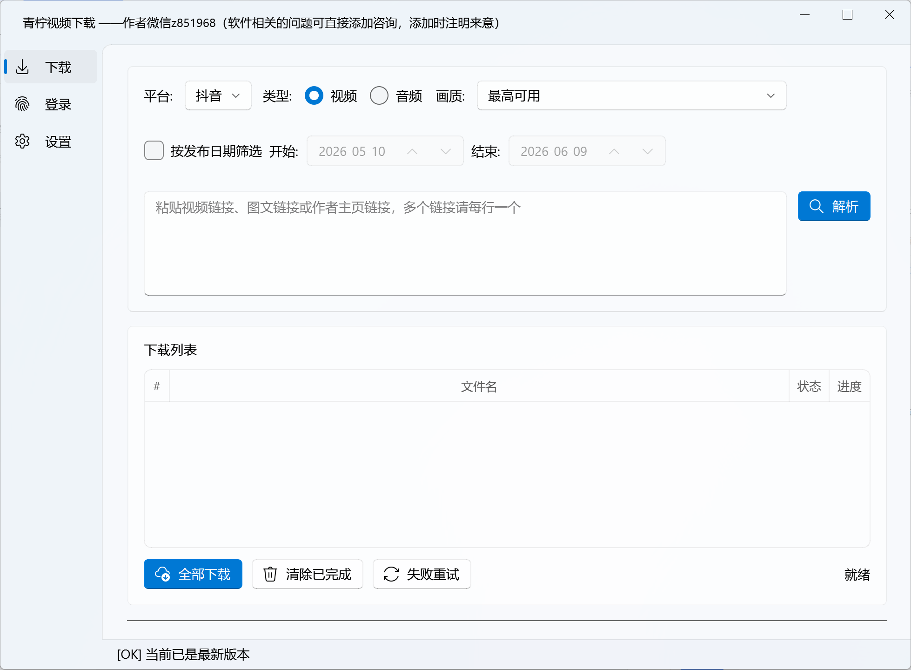
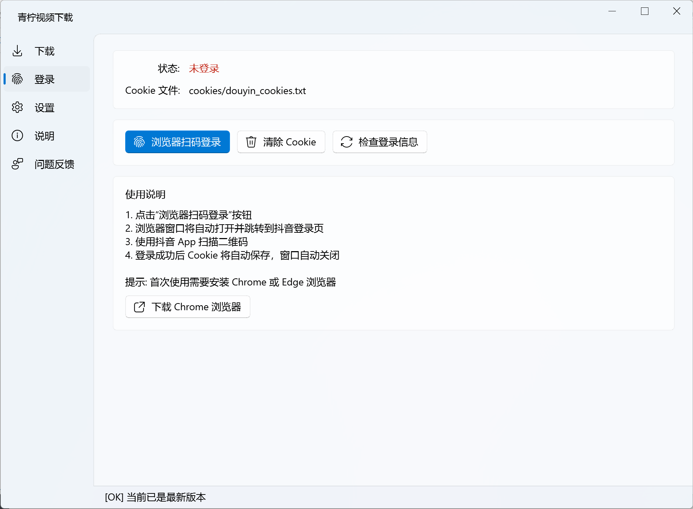
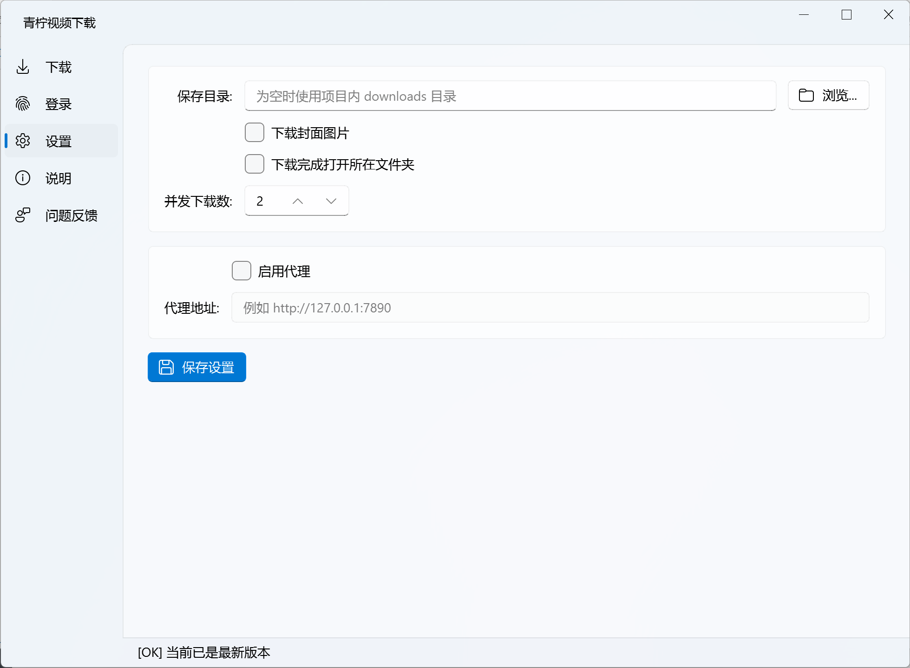

# 抖音视频下载器

一个以 QFluentWidgets GUI 为主的抖音视频下载工具，支持浏览器扫码登录、Cookie 持久化、`a_bogus` 参数签名、批量解析链接、作者主页作品解析、画质选择以及并发下载。项目同时保留了早期的命令行入口，方便在 GUI 不可用时作为备用方案使用。

> 说明：本项目仅供个人学习、研究和下载本人有权保存的内容使用。请遵守抖音平台规则、当地法律法规以及作品版权要求，不要用于批量搬运、侵权传播或任何违反平台条款的用途。

## 截图





## 功能特性

- 图形界面：基于 `PyQt-Fluent-Widgets`，标题为“青柠视频下载”，左侧导航包含下载、登录、设置和说明。说明页展示 `APP_VERSION`、作者微信及教程入口。
- 使用权限：后台登记电脑身份并校验使用期限，到期后点击下载才显示单个窗口选套餐和扫码付款；付费授权确认后自动继续下载，体验期间不显示授权入口或收费信息。
- 浏览器扫码登录：优先使用 `undetected_chromedriver`，失败后可降级到 Playwright。
- Cookie 管理：登录 Cookie 保存为 Netscape 格式，默认路径为 `cookies/douyin_cookies.txt`。
- 抖音接口签名：通过 `f2.utils.abogus` 生成 `a_bogus` 参数，调用抖音 Web API 获取视频信息。
- 单视频解析：支持抖音短链、普通视频链接、图文/笔记链接以及带 `modal_id` 的页面链接。
- 作者主页解析：支持从抖音用户主页链接中提取 `sec_user_id`，分页获取作者公开作品。
- 批量输入：下载页支持每行一个链接，解析后加入下载队列。
- 视频/音频切换：GUI 可选择下载视频或从作品音乐信息中提取音频链接。
- 画质选择：解析到多个视频源时，可按最高可用、1080p、720p、540p、480p、最低可用或默认源选择。
- 并发下载：可在设置页配置并发数，下载进度会回写到 GUI 列表和底部进度条。
- 更新检查：GUI 启动后会请求远程版本配置，发现新版本时弹出下载入口。
- 浏览器地址栏中的 `/jingxuan?modal_id=作品编号` 与分享短链接共用视频详情流程。Web API 使用本地 Cookie 的 UIFID、同源指纹及 SecSDK 签名；明确的 Argus 身份拒绝不盲目重试，其他临时 403 最多请求三次。
- 登录页“检查登录信息”只检查本地 Cookie 是否存在、是否超过保存的有效期；实际接口是否允许访问，以解析结果为准。
- 旧版 CLI 保留：`douyin_downloader.py` 仍可作为命令行版本运行。
- 平台扩展接口：通过 `BasePlatform` 抽象，后续可按目录约定添加新的平台实现。


## 修改客户端版本号

.\core\update_checker.py 中的 update_checker.py 值


## 当前支持范围

当前内置平台只有抖音：

| 类型 | 支持情况 |
| --- | --- |
| 抖音短链 `https://v.douyin.com/...` | 支持，会自动跟随跳转 |
| 视频链接 `https://www.douyin.com/video/<id>` | 支持 |
| 图文/笔记链接 `https://www.douyin.com/note/<id>` | 支持解析 ID，能否下载取决于接口返回的视频资源 |
| 带 `modal_id` 的页面链接 | 支持从查询参数提取作品 ID |
| 作者主页 `/user/<sec_user_id>` | 支持分页获取公开作品 |
| 需要登录或权限受限内容 | 需要有效 Cookie，仍可能因权限、删除、风控等原因失败 |


## 运行环境

推荐环境：

- Windows 10/11
- Python 3.10 或更高版本
- Chrome 或 Edge 浏览器
- 可访问抖音 Web 端和 ChromeDriver 下载源的网络环境

主要依赖：

- `f2`：提供 `a_bogus` 签名相关能力。
- `PyQt5`：Qt GUI 基础库。
- `PyQt-Fluent-Widgets`：QFluentWidgets 风格 GUI 组件。
- `requests`：HTTP 请求和流式下载。
- `undetected-chromedriver`：优先使用的扫码登录浏览器自动化方案。
- `selenium`：浏览器控制层。
- `playwright`：可选降级方案。

运行依赖已写入 `requirements.txt`。Playwright 作为可选兜底方案在文件中保留为注释，需要时单独安装。

## 快速开始

### 1. 创建并激活虚拟环境

Windows PowerShell：

```powershell
python -m venv venv
.\venv\Scripts\Activate.ps1
```

Git Bash：

```bash
python -m venv venv
source venv/Scripts/activate
```

### 2. 安装依赖

```bash
python -m pip install -U pip
pip install -r requirements.txt
```

如果希望启用 Playwright 降级方案：

```bash
pip install playwright
python -m playwright install chromium
```

### 3. 启动 GUI

```bash
python main.py
```

首次使用时，进入「登录」界面，点击浏览器扫码登录按钮，用抖音 App 扫码登录。登录成功后，Cookie 会保存到 `cookies/douyin_cookies.txt`，后续启动会自动复用。

## GUI 使用流程

1. 启动程序：

   ```bash
   python main.py
   ```

2. 登录：

   - 打开「登录」界面。
   - 点击浏览器扫码登录。
   - 在弹出的浏览器中使用抖音 App 扫码。
   - 程序检测到 `sessionid` 或 `sid_tt` 后会保存 Cookie。

3. 解析链接：

   - 回到「下载」界面。
   - 选择平台，目前默认为「抖音」。
   - 选择下载类型：视频或音频。
   - 下载视频时可选择画质偏好。
   - 解析作者主页时，如需限制作品发布日期，可勾选「按发布日期筛选」并选择开始、结束日期；默认不启用筛选。
   - 在输入框中粘贴一个或多个链接，每行一个。
   - 点击「解析」，或使用 `Ctrl + Enter`。

4. 下载：

   - 解析成功后，作品会进入下载列表。
   - 点击「全部下载」开始并发下载。
   - 文件名会按队列顺序自动加序号前缀，便于保持下载顺序。

## CLI 备用入口

如果只想使用命令行版本，可以运行：

```bash
python douyin_downloader.py
```

CLI 版本会在首次运行时尝试扫码登录，并把 Cookie 保存到项目根目录下的 `douyin_cookies.txt`。GUI 入口 `main.py` 启动时会自动把旧路径的 Cookie 迁移到 `cookies/douyin_cookies.txt`。

CLI 版本主要面向单链接交互下载；GUI 版本功能更完整，推荐优先使用 GUI。

## 打包发布

项目包含 Windows 下的 PyInstaller 打包脚本：

```powershell
.\build_exe.ps1
```

也可以双击或运行：

```bat
package_release.bat
```

脚本会在缺少 PyInstaller 时自动安装，随后执行编译检查、清理旧的 `build/` 和 `dist/`，生成 `dist/DouyinDownloader/`，并默认打包 zip 到 `release/`。`build/`、`dist/`、`release/` 和自动生成的 `.spec` 文件都属于本地构建产物，默认不提交到 GitHub。

## 配置说明

配置文件为项目根目录下的 `config.json`。该文件会保存本机下载路径和代理设置，已在 `.gitignore` 中忽略；仓库中提供 `config.example.json` 作为示例：

```json
{
  "download_dir": "",
  "proxy_enabled": false,
  "proxy_url": "",
  "max_concurrent": 2,
  "download_cover": false,
  "open_folder_after": false
}
```

字段说明：

| 字段 | 说明 |
| --- | --- |
| `download_dir` | 下载文件保存目录。为空时 GUI 会使用项目内的 `downloads/`。 |
| `proxy_enabled` | 代理开关，目前设置页可保存该值。 |
| `proxy_url` | 代理地址，目前请求层尚未实际读取该字段。 |
| `max_concurrent` | 并发下载数量。 |
| `download_cover` | 封面下载开关，目前代码已解析 `cover_url`，但 GUI 下载流程尚未接入封面保存。 |
| `open_folder_after` | 单个文件下载完成后，在资源管理器中定位文件。 |

## 目录结构

```text
.
├── README.md                       # 项目说明
├── .gitignore                      # GitHub 上传忽略规则
├── main.py                         # GUI 入口：注册平台并启动主窗口
├── douyin_downloader.py            # 旧版命令行入口
├── requirements.txt                # 运行依赖
├── config.example.json             # 示例配置
├── build_exe.ps1                   # Windows PyInstaller 打包脚本
├── package_release.bat             # 打包脚本快捷入口
├── images/                         # README 截图
├── core/                           # 平台无关基础能力
│   ├── base_platform.py            # BasePlatform 抽象类和 VideoInfo 数据结构
│   ├── browser_login.py            # 扫码登录流程，uc.Chrome 优先，Playwright 兜底
│   ├── chromedriver_util.py        # ChromeDriver 检测、下载与缓存
│   ├── cookie_manager.py           # Netscape 格式 Cookie 读写
│   ├── downloader.py               # 流式下载和进度回调
│   ├── paths.py                    # 源码运行和 exe 运行时路径
│   └── update_checker.py           # 远程版本检查
├── gui/                            # QFluentWidgets GUI
│   ├── app.py                      # 主窗口、左侧导航和状态栏
│   ├── download_tab.py             # 链接解析、下载队列、并发下载
│   ├── login_tab.py                # 登录状态和 Cookie 操作
│   ├── settings_tab.py             # 设置页和 config.json 编辑
│   └── widgets.py                  # 进度条、下载列表组件
├── platforms/
│   └── douyin/
│       ├── platform.py             # DouyinPlatform 实现
│       ├── api.py                  # 抖音 API 参数、请求头、a_bogus 签名
│       └── url_parser.py           # 链接解析和文件名清理
├── cookies/                        # 登录 Cookie，公开上传前不要提交真实文件
├── downloads/                      # 下载输出目录
└── logs/                           # f2 或历史运行日志
```

## 架构说明

项目采用平台抽象加 GUI 编排的结构。

核心数据流：

```text
扫码登录
  -> core.browser_login.perform_browser_login()
  -> core.cookie_manager.save_cookies()
  -> cookies/<platform>_cookies.txt

解析链接
  -> gui.download_tab.DownloadTab._parse_url()
  -> platform.extract_video_id() 或 platform.extract_profile_id()
  -> platform.get_video_info() 或 platform.get_profile_videos()
  -> core.base_platform.VideoInfo

下载文件
  -> gui.download_tab.DownloadTab._start_all_downloads()
  -> core.downloader.download_video()
  -> 保存到 download_dir
```

`BasePlatform` 定义了平台需要实现的接口：

- `name`
- `display_name`
- `cookie_domain`
- `login_url`
- `session_cookie_names`
- `extract_video_id(url)`
- `get_video_info(video_id, cookies)`
- `sanitize_filename(title)`
- `build_download_headers(cookies)`
- `resolve_short_url(url)`

抖音平台额外实现了：

- `extract_profile_id(url)`
- `get_profile_videos(profile_id, cookies, progress_callback=None, *, start_time=None, end_time=None)`

## 添加新平台

新增平台时建议按下面的步骤：

1. 在 `platforms/<platform_name>/` 下创建：

   ```text
   platform.py
   api.py
   url_parser.py
   __init__.py
   ```

2. 在 `platform.py` 中继承并实现 `BasePlatform`。

3. 如果平台需要登录，配置：

   - `cookie_domain`
   - `login_url`
   - `session_cookie_names`

4. 在 `main.py` 中导入并注册平台：

   ```python
   from platforms.example.platform import ExamplePlatform

   platforms = [
       DouyinPlatform(),
       ExamplePlatform(),
   ]
   ```

5. 如果平台 API 需要签名或特殊请求头，把逻辑放在对应平台的 `api.py` 中，不要写进 GUI 层。

## 常见问题

### 1. 提示未登录或 Cookie 无效

进入「登录」标签页重新扫码登录。如果仍失败，可以删除 `cookies/douyin_cookies.txt` 后重新登录。

### 2. 浏览器没有打开或 ChromeDriver 失败

确认已经安装 Chrome 或 Edge，并安装了依赖。GUI 登录失败时会弹出最后一条错误信息，完整运行日志位于 `logs/app.log`。

ChromeDriver 会先通过 Google 官方版本索引匹配 Chrome 的构建版本，未找到时再匹配同一主版本，避免直接使用浏览器补丁版本号导致下载地址返回 404。

```bash
pip install undetected-chromedriver selenium
```

如果 `undetected_chromedriver` 不可用，可以安装 Playwright：

```bash
pip install playwright
python -m playwright install chromium
```

### 3. API 返回错误或视频不可用

常见原因包括：

- Cookie 失效。
- 作品已删除、私密、仅好友可见或区域受限。
- 抖音 Web API 或风控策略发生变化。
- `f2` 的 `a_bogus` 签名实现与当前接口不兼容。

### 4. 下载音频失败

音频下载依赖作品接口返回的 `music.play_url`。部分作品可能没有可用音频链接，此时应切回视频下载。

### 5. 代理设置为什么没有生效

当前设置页能保存 `proxy_enabled` 和 `proxy_url`，但 `requests.get()` 调用尚未接入 `proxies` 参数。如需代理，需要在 `platforms/douyin/platform.py` 和 `core/downloader.py` 的请求处扩展。

### 6. 作者主页只解析出第一页作品

先在「登录」页重新扫码登录，再解析主页。登录过期时，接口可能仍返回第一页公开作品，但后续页只返回 `status_code`，没有作品列表和分页字段。

程序读取 Cookie 时会排除已过期的 Cookie，并在解析前检查登录 Cookie。不完整分页响应会最多请求三次；仍不完整或分页游标异常时，会提示「解析未完成」，不会把已获取的第一页误报为全部作品。要获取全部作品，请确认未勾选「按发布日期筛选」。

## GitHub 上传前检查

公开仓库前请重点检查隐私文件和本地构建产物。当前项目会生成或包含以下本地数据：

- `cookies/douyin_cookies.txt`：包含登录态 Cookie，不能公开。
- `logs/`：可能包含运行日志或调试信息。
- `config.json`：可能包含你的本机下载路径和代理信息。
- `downloads/`：下载输出目录，通常不应提交。
- `build/`、`dist/`、`release/`：本地打包产物，通常不应提交。
- `.payment-test/`、`服务端/payment_reuse/`：本地联调记录、临时预览和旧参考代码，当前程序不依赖这些目录。
- `服务端/支付代码.txt`、`.env`、数据库及证书私钥：仅保留在本地或服务器，不能提交商户密钥、订单或用户数据。
- `payment_credentials/`、`payment_client.json`：本机凭据和连接配置，不提交；连接配置示例使用 `payment_client.example.json`。
- `_debug_curl.html`、`要下载的.txt`、`细节记录.txt`：历史调试文件，如果包含个人链接或调试内容，建议不要上传。

如果这些文件已经被 Git 跟踪，仅添加 `.gitignore` 不会自动停止跟踪。可以在上传前执行类似命令：

```bash
git rm --cached cookies/douyin_cookies.txt
git rm --cached config.json
git rm -r --cached downloads logs build dist release
```

当前 `.gitignore` 已经覆盖这些路径，核心规则包括：

```gitignore
config.json
cookies/*.txt
downloads/
logs/
build/
dist/
release/
__pycache__/
venv/
.env
.env.*
!.env.example
服务端/支付代码.txt
服务端/payment_reuse/
.payment-test/
payment_credentials/
payment_client.json
*.db
*.db-*
*.sqlite
*.sqlite-*
*.sqlite3
*.sqlite3-*
*.pem
*.key
*.p12
*.pfx
*.zip
```

如果需要调整默认配置，请修改 `config.example.json` 或 README 示例，不要提交自己的真实 `config.json`。

保留客户端和服务端源码、`tests/` 回归测试、`docs/` 说明、`服务端/videoDown.txt` 和配置示例。不要删除本机凭据来整理仓库，这些文件已被忽略；删除可能导致原授权身份无法恢复。

## 已知限制

- 当前主要按 Windows 环境实现，ChromeDriver 自动下载路径使用的是 Windows 版本。
- 抖音接口和风控策略可能变化，项目可用性依赖当前 Web API、Cookie 和签名逻辑。
- 代理设置和封面下载开关目前已经出现在配置与 UI 中，但下载请求和封面保存逻辑尚未完整接入。
- GUI 当前只注册了抖音平台；其他平台需要按 `BasePlatform` 接口自行扩展。
- 打包脚本当前面向 Windows/PyInstaller；分发包默认使用 `undetected_chromedriver`，失败后会尝试 Edge/Selenium，安装 Playwright 时也可作为兜底方案。

## 许可证

当前仓库尚未包含 `LICENSE` 文件。上传 GitHub 前建议根据你的开源意愿选择合适的许可证，例如 MIT、Apache-2.0 或仅保留私有使用声明。
